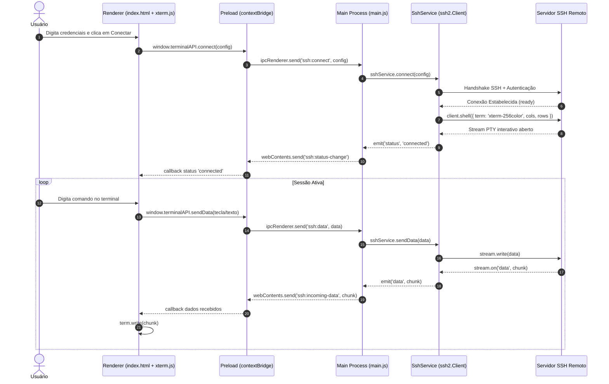

# Protótipo de Terminal SSH em Electron (Node.js + ssh2 + xterm.js)

Este protótipo implementa a arquitetura desacoplada padrão para clientes de terminal modernos baseados em Electron (como VS Code Terminal, Hyper, Tabby e Termius).

---

## 1. Arquitetura e Grafo de Comunicação IPC



---

## 2. Estrutura de Módulos

- **`src/main/main.js`**:
  - Controla o ciclo de vida do Electron (`app`, `BrowserWindow`).
  - Configura a ponte IPC (`ipcMain`).
  - Encaminha eventos assíncronos do `SshService` para o `webContents` da janela ativa.

- **`src/main/ssh-service.js`**:
  - Encapsula a biblioteca `ssh2`.
  - Gerencia o ciclo de vida da conexão de rede SSH, autenticação e alocação do PTY (`client.shell`).
  - Trata redimensionamento (`stream.setWindow`) e eventos de erro e desconexão.

- **`src/preload/preload.js`**:
  - Barreira de segurança isolando o Renderer do Node.js (`contextIsolation: true`, `nodeIntegration: false`).
  - Expõe a API controlada `window.terminalAPI` através de `contextBridge`.

- **`src/renderer/`**:
  - `index.html`: Layout da interface, inputs de conexão e container do terminal.
  - `renderer.js`: Gerenciamento do `xterm.js`, `FitAddon`, captura de entrada e renderização de saída.
  - `style.css`: Estilização escura de alta fidelidade para terminal.

---

## 3. Como Executar

```bash
cd ssh-terminal-prototype
npm install
npm start
```
